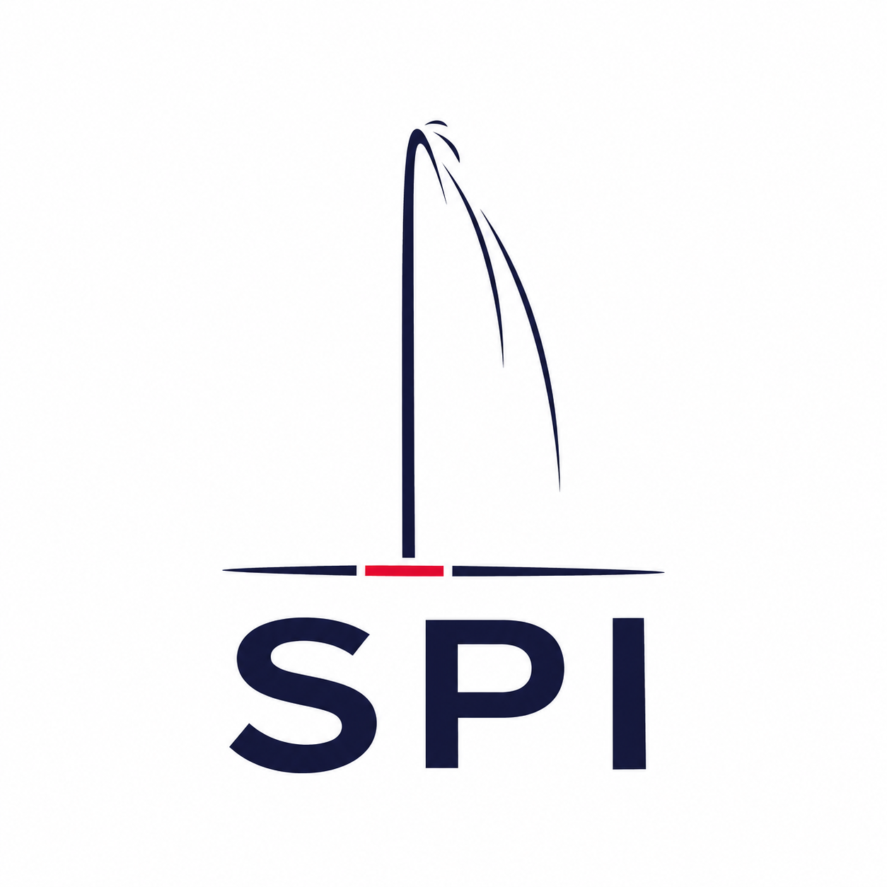

<p align="center">
  <a href="https://www.swiss-premium-insurance.ch/"></a>
</p>

<h1 align="center">Swiss Premium Insurance · MCP</h1>

<p align="center">
  Connect AI assistants to Swiss Premium Insurance’s LAMal comparison service.<br>
  <a href="https://www.swiss-premium-insurance.ch/"><strong>Company website ↗</strong></a>
  &nbsp; · &nbsp;
  <a href="https://assurs.ch/agents/">Service documentation</a>
  &nbsp; · &nbsp;
  <a href="mailto:contact@sp-insurance.ch">Contact SPI</a>
</p>

## Connect

Add a remote MCP server in your assistant or development tool:

| Setting | Value |
| --- | --- |
| Display name | Swiss Premium Insurance |
| Server URL | `https://api.assurs.ch/mcp` |
| Transport | Streamable HTTP |
| Authentication | None for the current public service |

The service is operated by **[Swiss Premium Insurance](https://www.swiss-premium-insurance.ch/)**, an insurance broker based in Geneva. Its live comparison service is hosted on the `assurs.ch` domain and identifies itself as `assurs-lamal` during the MCP handshake.

This repository contains connection instructions, client configuration examples and protocol requests. The remote service runs on SPI’s infrastructure; there is nothing to deploy locally.

## Client integrations

### Claude Code

```sh
claude mcp add --transport http spi-insurance https://api.assurs.ch/mcp
```

For a shared project configuration, merge [integrations/claude-code.json](integrations/claude-code.json) into the project’s `.mcp.json`. Check the connection with `claude mcp get spi-insurance`.

### VS Code

Merge [integrations/vscode.json](integrations/vscode.json) into `.vscode/mcp.json`, then enable the server in VS Code’s MCP server controls. Preserve your existing server entries when merging.

### Gemini CLI

```sh
gemini mcp add --transport http spi-insurance https://api.assurs.ch/mcp
```

Alternatively, merge [integrations/gemini-cli.json](integrations/gemini-cli.json) into your Gemini CLI settings. The example uses `httpUrl` for Streamable HTTP.

### Other MCP clients

Use the connection settings above in a client that supports remote Streamable HTTP MCP servers. Select no authentication when prompted. A client that only supports local `stdio` servers needs its own HTTP adapter.

Client format references: [Claude Code](https://code.claude.com/docs/en/mcp), [VS Code](https://code.visualstudio.com/docs/agents/reference/mcp-configuration), [Gemini CLI](https://geminicli.com/docs/tools/mcp-server/).

## Available tools

| Tool | Purpose |
| --- | --- |
| `compare_lamal_premiums` | Compare basic health insurance premiums for one person. |
| `compare_lamal_household` | Compare premiums for a household. |
| `get_lamal_metadata` | Read supported criteria, tariff years, data sources and service availability. |
| `get_active_customer_rewards` | Read the currently published customer reward terms and availability. |
| `create_adviser_handoff_link` | Obtain an optional link to continue through a web form. |
| `test_adviser_request` | Validate a request with synthetic contact details, without sending it. |
| `request_adviser_contact` | Send an approved adviser request to SPI. |

Use `tools/list` for the current input schemas and follow the instructions returned by the service. Read current tariff years, conditions and availability from the API instead of hard-coding them.

`request_adviser_contact` sends the client’s approved details to SPI. Ask for the client’s consent using the service’s consent text before calling it. For development, use `test_adviser_request` with synthetic details. A successful adviser request is a delivery receipt, not an insurance contract.

## Check the connection

From a checkout of this repository, run these three requests in order. They initialize the connection and list tools; they do not submit an adviser request.

```sh
curl --fail-with-body --max-time 30 https://api.assurs.ch/mcp \
  -H 'Content-Type: application/json' \
  -H 'Accept: application/json, text/event-stream' \
  --data-binary @examples/initialize.json

curl --fail-with-body --max-time 30 https://api.assurs.ch/mcp \
  -H 'Content-Type: application/json' \
  -H 'Accept: application/json, text/event-stream' \
  -H 'MCP-Protocol-Version: 2025-11-25' \
  --data-binary @examples/initialized.json

curl --fail-with-body --max-time 30 https://api.assurs.ch/mcp \
  -H 'Content-Type: application/json' \
  -H 'Accept: application/json, text/event-stream' \
  -H 'MCP-Protocol-Version: 2025-11-25' \
  --data-binary @examples/tools-list.json
```

The current service accepts protocol `2025-11-25` and returns JSON without a session ID. The initialized notification returns HTTP 202 with an empty body. A browser GET to `/mcp` returns HTTP 405; connect with an MCP client or use the POST requests above.

These requests were checked against the live service on 4 November 2026. The service returned `assurs-lamal` version `1.1.0` and seven tools. Client configuration formats were checked against the linked documentation; each client’s login and workspace policy can affect availability.

## Documentation & contact

- [Swiss Premium Insurance](https://www.swiss-premium-insurance.ch/) — company, services and team.
- [MCP connection guide](https://assurs.ch/agents/connect.html) — hosted service documentation.
- [Service privacy notice](https://assurs.ch/agents/privacy.html) and [terms](https://assurs.ch/agents/terms.html).
- [Model Context Protocol](https://modelcontextprotocol.io/specification/2025-11-25/basic/transports) — transport specification.
- [contact@sp-insurance.ch](mailto:contact@sp-insurance.ch) — business contact.

Please keep personal client information out of GitHub issues and discussions.
